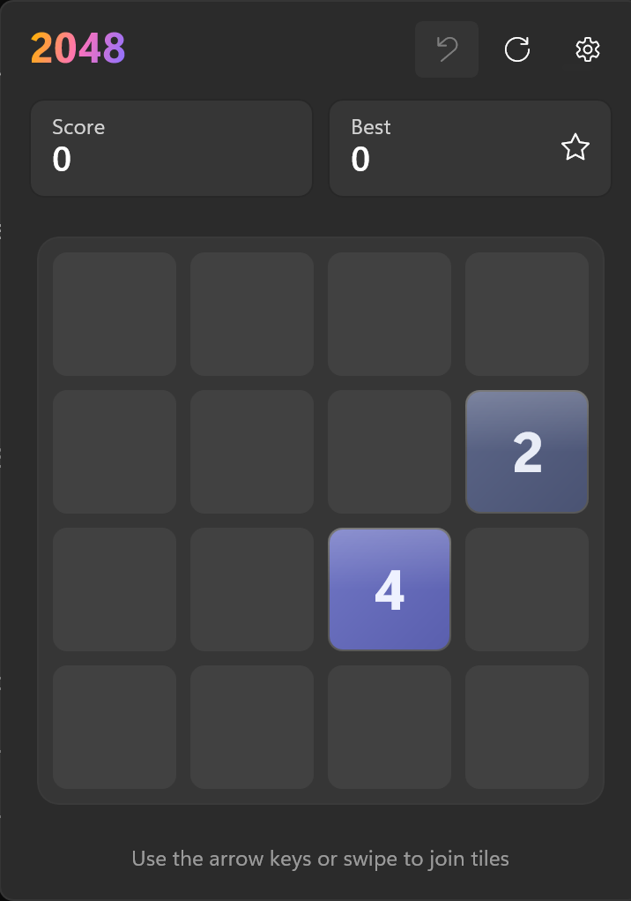

# Tray 2048



Click the tray icon, play a few moves, click away. Your game is waiting when you come back.

Tray 2048 is a WinUI 3 app that lives in the Windows notification area. It has no main window: the tray icon opens a small, always-on-top flyout anchored next to the icon, with the classic 2048 puzzle inside.

## Features

- **The game:** slide tiles with the arrow keys, WASD, a gamepad D-pad, or a touch swipe. Equal tiles merge, and reaching 2048 wins (you can keep going).
- **Animated board:** tiles slide, pop when they merge, and fade in when they spawn.
- **Undo:** step back one move with the Undo button or `Ctrl+Z`.
- **New game:** the New game button or `Ctrl+N`.
- **Best score:** tracked across games, with a "New best" highlight when you beat it. Reset it from Settings.
- **Always saved:** the game is saved after every move, so closing the flyout, exiting, or restarting Windows never loses a run.
- **Tray tooltip:** hover the icon to see the current score and best.
- **Light dismiss:** the flyout hides when it loses focus, and clicking the tray icon again toggles it. `Esc` hides it, or backs out of Settings first.
- **Tray menu:** right-click the icon for Play 2048, New game, Settings, and Exit.
- **Settings:** Start with Windows, and reset best score. They open inside the flyout rather than in a separate window.
- **Theme-aware:** the flyout matches the taskbar's light or dark mode and accent tint, and the tray icon switches between a white and a dark glyph to stay visible on either taskbar.
- **Single instance:** launching the app again opens the running instance's flyout instead of adding a second tray icon.

## Requirements

- Windows 10 1809 (build 17763) or later, x64 or ARM64.
- To build from source: the [.NET 10 SDK](https://dotnet.microsoft.com/download), the [winapp CLI](https://github.com/microsoft/WinAppCli) (`winget install Microsoft.WinAppCli --source winget`), and **Developer Mode** turned on (Settings > System > For developers) so the app can be registered with package identity.

## Install

Download the signed MSIX for your architecture from the [GitHub releases](../../releases) page. Look in the taskbar overflow (^) if the icon is hidden after the first launch.

## Run from source

From the repository root:

```powershell
$Platform = if ($env:PROCESSOR_ARCHITECTURE -eq 'AMD64') { 'x64' } else { $env:PROCESSOR_ARCHITECTURE }
dotnet run -c Debug -p:Platform=$Platform
```

`dotnet run` goes through the `Microsoft.Windows.SDK.BuildTools.WinApp` package, which registers a loose-layout package with the winapp CLI and launches the app by AUMID. Package identity is required for settings storage and the startup task. `winapp run` does the same thing, and `winapp run --clean` wipes saved data so you can see the first-run experience again.

In Debug builds, `Ctrl+Shift+W` and `Ctrl+Shift+L` load a board one move from winning or losing, for checking the overlays.

## Tests

The game rules live in `Game/GameEngine.cs`, which has no WinRT dependency. The test project links it directly:

```powershell
dotnet test tests/Tray2048.Tests
```

## Privacy and footprint

- **No network access.** The app makes no network calls and declares no network capability in its manifest.
- **No secrets.** The only thing stored is your game state, score, and best score, in the app's local settings. There are no accounts, API keys, or telemetry.
- **Nothing runs while hidden.** The flyout is hidden on dismiss and closed after a minute, and the app then returns its memory to Windows. Idle, it is just a tray icon.
- **Crash log:** unhandled exceptions are appended to `%TEMP%\Tray2048-crash.log`.

## Project layout

| Path | What it holds |
|---|---|
| `App.xaml.cs` | Tray icon, context menu, single-instance mutex and "show flyout" event, crash logging, the only exit path |
| `Game/GameEngine.cs` | All the rules: moves, merges, scoring, undo, save and load |
| `Views/TrayFlyoutWindow` | The flyout window: placement, light dismiss, slide and fade animation, idle close |
| `Views/FlyoutPage` | The game page: score, buttons, keyboard and swipe input, saving |
| `Views/GameBoard`, `Views/TileView` | Board rendering and animation, and the visual state for each tile value |
| `Views/SettingsPage` | Start with Windows and reset best score |
| `Themes/Game.xaml` | Tile and board colors |
| `Controls/ShellBackdrop.cs` | Acrylic backdrop that matches the shell's own flyouts |
| `Services/` | Window placement, system theme, settings, startup task, memory release |
| `tests/Tray2048.Tests` | Unit tests for the engine |
| `build-msix-for-gh.ps1` | Builds signed x64 and ARM64 MSIX packages and a draft GitHub release |

## Releasing

Bump `Identity/@Version` in `Package.appxmanifest`, then run `build-msix-for-gh.ps1` from the repository root. It builds and signs an MSIX per architecture and creates a draft GitHub release for you to publish. The publish profiles in `Properties\PublishProfiles` are gitignored, so a fresh clone needs them restored first.

## Troubleshooting

- **The "Start with Windows" switch is disabled:** the app is running without package identity. Launch it with `dotnet run` or `winapp run`.
- **Launch fails because an old instance is running:** exit it from the tray menu, or run `taskkill /IM Tray2048.exe /F`.
- **Remove the dev registration:** run `winapp unregister` from the repository root.

## License

MIT, see [LICENSE](LICENSE).
